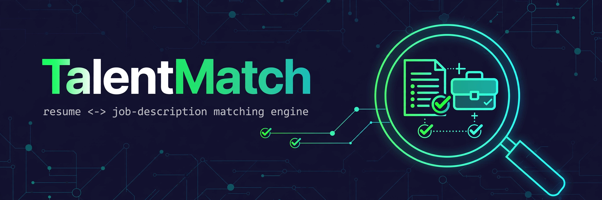
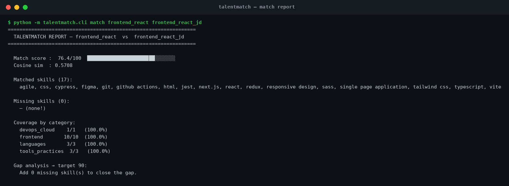
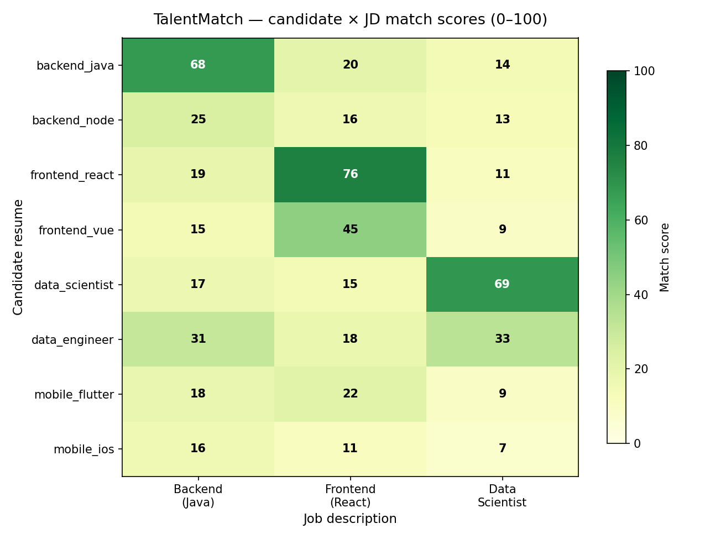
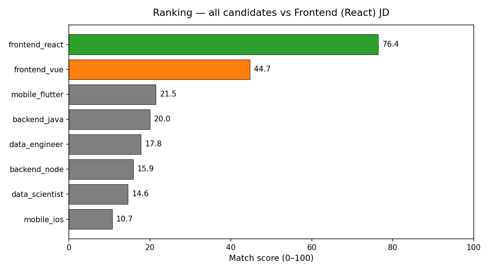

# TalentMatch — resume↔JD matching engine


**Paste in a resume and a job description — get a 0–100 match score, the exact skills that matched, what's missing, and what to learn next.**



TalentMatch is a from-scratch **TF-IDF + cosine similarity** matching engine with a curated tech-skill vocabulary and phrase-level skill extraction. No ML frameworks, no API keys, no network — the core engine is pure Python stdlib.

## Features

- **Match scoring (0–100)** — blends TF-IDF cosine similarity with JD skill coverage
- **Skill extraction** — 90+ curated skills across 8 categories, with multi-word phrase matching ("spring boot", "tailwind css") and no false positives on word components
- **Coverage breakdown** — per-category matched/total, e.g. `backend 7/7 (100%)`
- **Gap analysis** — "to reach 90% for this JD, add these skills"
- **Batch ranking** — rank every candidate resume against a JD in one table
- **CLI** — `match`, `rank`, `gaps`, `demo` (+ `--json` output)
- **Bundled sample data** — 8 fictional resumes (backend ×2, frontend ×2, data ×2, mobile ×2) and 3 fictional JDs

## Screenshots

### Match report (real CLI output)



### Candidate × JD score heatmap (real output)



### Ranking all candidates for the React frontend JD (real output)



## Tech stack

| Piece | How |
|---|---|
| TF-IDF | Implemented from scratch (`talentmatch/engine.py`) — smoothed IDF, sparse dict vectors |
| Cosine similarity | Sparse-vector dot product, from scratch |
| Skill extraction | Token-sequence phrase matching over a curated `skills.json` vocabulary (longest-phrase-first, overlap-safe) |
| Scoring | `score = 100 × (0.55 × cosine + 0.45 × skill_coverage)` |
| CLI | `argparse`, human-readable + `--json` |
| Charts | matplotlib (dev/visuals only — the engine itself is stdlib-only) |
| Tests | pytest, 14 tests |

## Quickstart

```bash
# 1. Clone and enter
git clone https://github.com/872000/talentmatch.git
cd talentmatch

# 2. (Optional) visuals need matplotlib
pip install -r requirements.txt

# 3. Score one resume against one JD
python -m talentmatch.cli match backend_java backend_java_jd

# 4. Rank every bundled resume for a JD
python -m talentmatch.cli rank frontend_react_jd

# 5. Skill-gap analysis: what to learn to hit 90%
python -m talentmatch.cli gaps frontend_vue frontend_react_jd --target 90

# 6. End-to-end demo
python -m talentmatch.cli demo

# 7. Run the test suite
python -m pytest -q
```

Example output:

```
  Match score :  76.4/100  ███████████████████████░░░░░░░
  Cosine sim  : 0.5708

  Matched skills (17):
    agile, css, cypress, figma, git, github actions, html, jest, next.js, ...

  Missing skills (0):
    — (none!)

  Coverage by category:
    frontend        10/10  (100.0%)
    languages        3/3   (100.0%)
```

## Project structure

```
talentmatch/
├── talentmatch/
│   ├── __init__.py      # public API: match, rank, gap_analysis, ...
│   ├── engine.py        # from-scratch TF-IDF, cosine similarity, skill extraction
│   ├── skills.json      # curated vocabulary: 90+ skills in 8 categories
│   └── cli.py           # match / rank / gaps / demo commands
├── data/
│   ├── resumes/         # 8 fictional sample resumes (markdown)
│   └── jds/             # 3 fictional sample job descriptions (markdown)
├── scripts/
│   ├── make_charts.py      # regenerates assets/heatmap.png + ranking.png
│   └── make_screenshot.py  # renders assets/cli_screenshot.png from real CLI output
├── assets/              # hero.png, heatmap.png, ranking.png, cli_screenshot.png
├── tests/
│   └── test_engine.py   # 14 pytest tests
├── requirements.txt
├── LICENSE
└── README.md
```

## How the scoring works

1. **Tokenise** both documents (lower-cased; `node.js`, `c#`, `c++` survive intact).
2. **TF-IDF** — fit a tiny vectoriser on the two documents (smoothed IDF: `log((1+N)/(1+df)) + 1`), producing sparse term vectors.
3. **Cosine similarity** between the vectors → base textual signal.
4. **Skill extraction** — phrase-match the curated vocabulary; compute the fraction of JD skills present in the resume.
5. **Final score** = `100 × (0.55 × cosine + 0.45 × skill_coverage)`, so both wording similarity and concrete skill overlap matter.

## Roadmap

- [ ] PDF/DOCX resume parsing
- [ ] Skill synonyms & seniority weighting ("5 yrs Python" > "1 yr Python")
- [ ] Export reports to HTML/PDF
- [ ] Web UI (single-page, still fully offline)
- [ ] Benchmark against a labelled hire/no-hire dataset

## License

MIT — see [LICENSE](LICENSE).
